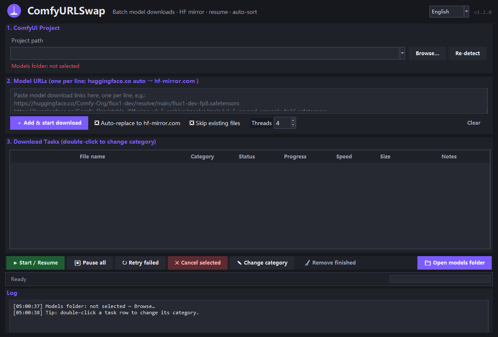

# ComfyURLSwap

**v1.2.0** · Windows · Pure Python (Tkinter), **zero third-party dependencies** · **8 UI languages**

**English** | [简体中文](docs/README_zh.md)



**ComfyURLSwap** is a small GUI downloader for ComfyUI model files. Paste a batch of
download links, and it will:

1. **Auto-detect your ComfyUI project** on startup (ComfyUI Desktop installs under
   `%LOCALAPPDATA%\Comfy-Desktop\ComfyUI-Installs`, portable packages on common drives,
   or pick a folder manually — your choice is remembered).
2. **Swap HuggingFace links to the China mirror** — `huggingface.co` → `hf-mirror.com`
   automatically (can be turned off). Pasted `/blob/` web-page URLs are converted to
   `/resolve/` direct-download URLs automatically.
3. **Download with multi-threading and resume support** — byte-level resume
   (`.part` + `Range`), survives pause / network loss / closing the app; task list is
   persisted and restored on next launch; failed tasks retry with backoff.
4. **File every model into the right folder** under `<project>\ComfyUI\models\`,
   detected from the URL / file name (double-click a task to override):

   | Model type | Destination folder |
   | --- | --- |
   | Checkpoint (SD1.5 / SDXL / Flux …) | `models/checkpoints/` |
   | Diffusion / UNet base (quantized `fp8/int8/nvfp4` …) | `models/diffusion_models/` |
   | LoRA | `models/loras/` |
   | VAE | `models/vae/` |
   | ControlNet | `models/controlnet/` |
   | Embedding / Textual Inversion | `models/embeddings/` |
   | CLIP / text encoder | `models/clip/` |
   | CLIP Vision | `models/clip_vision/` |
   | UNet / diffusion model | `models/unet/` |
   | Upscaler (ESRGAN …) | `models/upscale_models/` |
   | IP-Adapter | `models/ipadapter/` |
5. **Talk to you in your language** — the whole UI *and* log messages are localized in
   English · 简体中文 · 日本語 · 한국어 · Español · Français · Deutsch · Русский,
   auto-detected from your system locale on first run and switchable live via the
   dropdown at the top-right (your choice is remembered).

## Download

* **Windows EXE (recommended, no Python needed):**
  [GitHub Releases](https://github.com/carychief-gpt/ComfyURLSwap/releases/latest) →
  download `ComfyURLSwap-v1.2.0.exe` and double-click it. `settings.json` / `tasks.json`
  (preferences, resume data) are created next to the EXE on first run.
* **Run from source:** Python 3.8+ (with tkinter), then `python main.py`.

## Usage

1. Select your ComfyUI project in **step 1** (auto-detected or browse).
2. Paste model download links into **step 2**, one per line, then click
   **“＋ Add & start”** — links are mirrored and queued automatically.
3. Watch progress in the task table; finished files land in `models\<category>\`.
   Use **Open model folder** to verify. Double-click a row to change its category
   (before download, or while paused).

Buttons: Start/Resume · Pause All · Retry Failed · Cancel Selected · Change Category ·
Remove Completed · Open Model Folder.

## Security / privacy

* The app stores **no accounts, no tokens, no credentials** — it only issues plain
  HTTP GET requests to the download links you paste.
* Runtime files `settings.json` (local paths, preferences) and `tasks.json`
  (your download history) are deliberately **excluded from this repository** via
  `.gitignore`, so nothing personal is ever uploaded. Delete them anytime.

## Build from source

```bash
pip install pyinstaller
pyinstaller --onefile --windowed --name ComfyURLSwap ^
  --icon tools\app.ico --add-data "tools\app.ico;." main.py
# → dist\ComfyURLSwap.exe
```

`tools\build_exe.bat` does the same on Windows; `tools\make_icon.py` regenerates the icon.

## Changelog

### v1.2.0
* **i18n:** entire UI + log/status messages localized — English, 简体中文, 日本語,
  한국어, Español, Français, Deutsch, Русский; auto-detected from system locale,
  live switch from the top-right language dropdown (persisted in settings)
* Category names (checkpoint / LoRA / CLIP …) fully translated in the task table and
  the category dialog
* Documentation reorganized into `docs/` (this file stays at the repo root because
  GitHub renders only the root README on the project home page)

### v1.1.1
* Fix: quantized base models (`int8/int4/fp8/nvfp4/convrot/gguf/awq`, Hyper-SD) now go to `diffusion_models`
* Fix: speed LoRAs (`turbo`, `Nstep`, `lightning`, `lightx2v`) now go to `loras` even without “lora” in the filename
* New `diffusion_models` category (modern ComfyUI standard folder; legacy `unet` still selectable)

### v1.0.0
* First release: project auto-detect, hf-mirror swap, multithreaded download, resume, task persistence, auto model routing

## Repo layout

```
main.py                  # entry point
urlswap/
  ui.py                  # Tkinter GUI (dark theme, i18n)
  i18n.py                # translations — 8 languages
  downloader.py          # multithread / resume / task persistence
  project.py             # ComfyUI project auto-detection
  classify.py            # model routing rules
  settings.py            # settings IO (EXE-aware)
docs/
  README_zh.md           # 简体中文文档
tools/
  build_exe.bat          # one-click EXE rebuild
  make_icon.py           # regenerate app icon
  shot.py                # regenerate screenshot.png
  smoke_test.py          # headless automated tests
```
