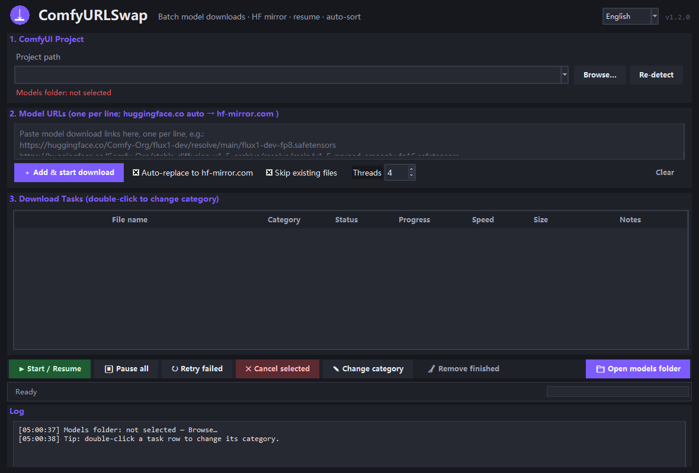

# ComfyURLSwap

**v1.2.0** · Windows · 纯 Python（Tkinter）实现，**零第三方依赖** · **界面支持 8 种语言**

[English](../README.md) | **简体中文**



**ComfyURLSwap** 是一个 ComfyUI 模型批量下载器小工具，粘贴一堆下载链接即可：

1. **自动检测 ComfyUI 项目**：启动即扫描 ComfyUI Desktop（`%LOCALAPPDATA%\Comfy-Desktop\ComfyUI-Installs`）
   与各盘符常见便携包目录，也可手动“浏览…”选择并记住。
2. **自动替换国内镜像**：`huggingface.co` → `hf-mirror.com`（可关闭）；粘贴 HF 的
   `/blob/` 网页地址会自动转换为 `/resolve/` 文件直链；服务器返回 HTML 网页时立即报错，不写坏文件。
3. **多线程 + 断点续传**：字节级续传（`.part` + `Range`），暂停 / 断网 / 关闭程序后再打开自动恢复；
   任务列表持久化，失败自动退避重试。
4. **自动归类落盘**：按 URL / 文件名识别模型类型，放入 `<项目>\ComfyUI\models\` 下对应子目录
   （双击任务行可手动修改分类）：

   | 模型类型 | 存放目录 |
   | --- | --- |
   | 大模型 / Checkpoint（SD1.5、SDXL、Flux 等） | `models/checkpoints/` |
   | Diffusion / UNet 底模（fp8/int8/nvfp4 等量化底模） | `models/diffusion_models/` |
   | LoRA | `models/loras/` |
   | VAE | `models/vae/` |
   | ControlNet | `models/controlnet/` |
   | Embedding / Textual Inversion | `models/embeddings/` |
   | CLIP / 文本编码器 | `models/clip/` |
   | CLIP Vision | `models/clip_vision/` |
   | UNet（单独扩散模型） | `models/unet/` |
   | 放大模型（ESRGAN 等） | `models/upscale_models/` |
   | IP-Adapter | `models/ipadapter/` |
5. **多国语言界面**：界面与日志全程本地化 —— English · 简体中文 · 日本語 · 한국어 ·
   Español · Français · Deutsch · Русский，首次启动按系统语言自动选择，右上角下拉框
   可随时切换并自动记住。

## 下载

* **Windows EXE（推荐，免 Python 环境）**：前往 [GitHub Releases](https://github.com/carychief-gpt/ComfyURLSwap/releases/latest)
  下载 `ComfyURLSwap-v1.2.0.exe`，双击即用；首次运行会在 EXE 同目录生成
  `settings.json` / `tasks.json`（配置与断点数据）。
* **源码运行**：Python 3.8+（自带 tkinter），执行 `python main.py` 或双击 `启动ComfyURLSwap.bat`。

## 使用说明

1. 第 1 步选择（或浏览选择）你的 ComfyUI 项目目录。
2. 第 2 步一行一条粘贴模型下载链接，点击 **“＋ 添加并开始下载”**，自动替换镜像并开始下载。
3. 任务表格实时显示进度 / 速度 / 总进度；完成后自动放入 `models\<分类>\`，
   可点“📁 打开模型目录”查看。双击任务行可修改分类（下载前或暂停时）。

按钮：开始/继续 · 暂停全部 · 重试失败 · 取消选中 · 修改分类 · 移除已完成 · 打开模型目录。
右上角下拉框可随时切换界面语言（8 种），选择会自动保存。

## 安全与隐私

* 程序**不存储任何账号、密码、令牌**，只对你粘贴的链接发起普通 HTTP 下载请求。
* 记录本地路径与下载历史的 `settings.json` / `tasks.json` 已通过 `.gitignore` 排除，
  **不会上传到本仓库**，随时可删除。

## 从源码打包 EXE

```bat
tools\build_exe.bat
```

或手动执行 `pyinstaller --onefile --windowed --name ComfyURLSwap --icon tools\app.ico --add-data "tools\app.ico;." main.py`。

## 更新日志

### v1.2.0
* **多语言**：整个界面 + 日志/状态信息全部本地化 —— 英语、简体中文、日语、韩语、
  西班牙语、法语、德语、俄语；按系统语言自动选择，右上角下拉框实时切换（自动记住）
* 任务表格与分类弹窗中的模型分类名称同步翻译
* 文档整理进 `docs/` 目录（根目录保留 README.md，因为 GitHub 首页只渲染根目录 README）

### v1.1.1
* 修复：量化底模（`int8/int4/fp8/nvfp4/convrot/gguf/awq`）与 Hyper-SD 类自动归类到 `diffusion_models`
* 修复：速度类 LoRA（`turbo`、`Nstep`、`lightning`、`lightx2v`）即使文件名不含 “lora” 也能识别归入 `loras`
* 新增 `diffusion_models` 分类（现代 ComfyUI 标准目录，旧版 `unet` 仍可选）

### v1.0.0
* 首个版本：项目自动检测、hf-mirror 域名替换、多线程下载、断点续传、任务持久化、模型自动归类

## 仓库结构

```
main.py                  # 入口
urlswap/
  ui.py                  # Tkinter 界面（深色主题、多语言）
  i18n.py                # 翻译文案（8 种语言）
  downloader.py          # 多线程下载 / 断点续传 / 任务持久化
  project.py             # ComfyUI 项目自动检测
  classify.py            # 模型分类规则
  settings.py            # 配置读写（自动适配 EXE 模式）
docs/
  README_zh.md           # 简体中文文档
tools/
  build_exe.bat          # 一键重新打包 EXE
  make_icon.py           # 生成程序图标
  shot.py                # 重新生成截图
  smoke_test.py          # 无界面自动化测试
```
